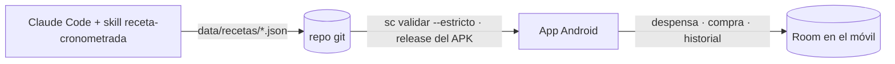

<div align="center">
  

  <h1>Sous Chef</h1>
  <p><b>Recetas cronometradas para cocinar con el móvil en la encimera.</b><br/>
  Qué haces, cuándo, en qué recipiente, a qué potencia y con la tapa dónde.</p>
</div>

---

## ✨ Qué hace

| | |
|---|---|
| 📖 **Recetas** | Lista con búsqueda, categorías, favoritas, la huella de fuegos de cada plato y cuánto hace que no lo cocinas |
| 📄 **Ficha** | Ingredientes que escalan con las raciones, gráfico de tiempos por recipiente, mise en place razonada, pasos con su porqué, cortes y decisiones. Se imprime en A4 |
| ⏱️ **Cronómetro** | Un temporizador por recipiente, horas de reloj calculadas hacia atrás desde la hora de servir, avisos dentro de cada paso, "mientras esto corre", retrasos y qué aguanta la espera. Suena con el móvil bloqueado |
| 🫙 **Despensa** | Lo que hay, lo que se acaba, lo que falta y lo que está vetado |
| 🛒 **Compra** | Lista agrupada por zonas del súper; añade lo que pide una receta con un toque |
| 🗓️ **Historial** | Lo cocinado con sus minutos reales y aviso de repetir base dos días seguidos |
| 🔪 **Técnicas** | Fichas de técnica enlazadas desde las recetas |

## 🗺️ Cómo funciona



Las recetas se diseñan con Claude Code en este repo, se validan con reglas de cocina estrictas y salen en una release del APK.
La app nunca las edita: las cocina. La despensa y el historial viven en Room, en el móvil; no hay backend y la app funciona sin conexión.

## 🧱 Stack
Kotlin · Jetpack Compose (Material 3) · Hilt · Room · WorkManager.
Módulos: `app/` (Android), `receta/` (dominio compartido: validador y motor del cronómetro), `tools/` (CLI `sc`).

## 📁 Estructura
```
app/        App Android (domain · data · ui)
receta/     Kotlin puro: modelos, escalado, gantt, validador, motor del cronómetro
tools/      CLI sc: validar, formatear
data/       Recetas y técnicas (fuente de verdad), datos legados
docs/       Estado, decisiones, ADRs, fases, reglas de cocina, especificación
.claude/    Skills, agentes y hooks de Claude Code
```

## 🚀 Puesta en marcha
Requisitos: JDK 21, Android SDK 36, Node ≥ 22 (hooks y comprobaciones).
```
python -I scripts/preparar-local-properties.py   # sdk.dir en local.properties (sin imprimir valores)
./gradlew assembleDebug                           # APK de desarrollo
scripts/sc validar --estricto                     # valida todas las recetas
```

| Comando | Para qué |
|---|---|
| `./gradlew ktlintCheck detekt lintDebug testDebugUnitTest assembleDebug` | Gate de Android |
| `./gradlew :receta:test` | Tests del dominio |
| `scripts/sc validar --estricto` | Valida recetas y técnicas antes de la release del APK |
| `node scripts/android-release.mjs` | APK firmado en local |

## 📚 Documentación
| | |
|---|---|
| [Estado](docs/ESTADO.md) | Dónde está el proyecto y la próxima acción |
| [Decisiones](docs/decisiones.md) | Decisiones cerradas y versiones |
| [Arquitectura](docs/arquitectura.md) y [ADRs](docs/adr/) | Por qué está hecho así |
| [Reglas de cocina](docs/cocina/reglas.md) | Vetos, potencias, completitud |
| [Esquema de receta](docs/cocina/esquema-receta.md) | El JSON y sus validaciones |
| [Herramientas](docs/herramientas.md) | La CLI `sc` |
| [Especificación de la app vieja](docs/spec/app-legado.md) | Contrato de paridad funcional |
| [Pasos manuales](docs/pasos-manuales.md) | Lo que hace el usuario |

## 🧑‍💻 Trabajar con Claude Code
Lee [CLAUDE.md](CLAUDE.md). Procedimientos en [docs/skills.md](docs/skills.md); especialistas en [docs/agentes.md](docs/agentes.md).
Para una receta nueva: pide el plato y la skill `receta-cronometrada` hace el resto.
