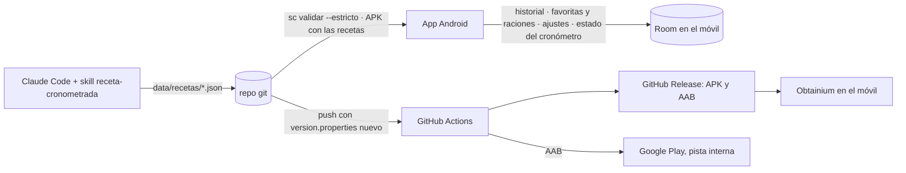

<div align="center">
  

  <h1>Sous Chef</h1>
  <p><b>Recetas cronometradas para cocinar con el móvil en la encimera.</b><br/>
  Qué haces, cuándo, en qué recipiente, a qué potencia y con la tapa dónde.</p>
</div>

---

## ✨ Qué hace

| | |
|---|---|
| 📖 **Recetas** | Buscador y cuadraditos por familia de base (pasta, arroz, patata…) que abren su lista. Filtros y orden en una hoja inferior, favoritas, tres diseños de tarjeta (Tinte, Franja, Clásica) y «empieza HH:mm» o «acabas HH:mm» en cada una |
| 📄 **Ficha** | Eliges la hora de servir y te dice a qué hora empezar. Ingredientes que escalan con las raciones, «Todo junto» o «Por zona», diagrama de tiempos por recipiente, mise en place, pasos con su porqué y cortes. Se imprime o se guarda en PDF |
| ⏱️ **Cronómetro** | Varios recipientes a la vez, con tres interfaces (Apilada, Foco y Clásica) y horas de reloj calculadas hacia atrás. Alarma también con el móvil bloqueado, deshacer el último paso y prórroga cuando el plato lo pide |
| 🎙️ **Voz** | Opcional: órdenes con las manos ocupadas («siguiente», «¿qué tengo que hacer?», prórroga) y respuestas habladas. Solo con la cocina en pantalla |
| 🔪 **Técnicas** | Fichas de técnica enlazadas desde las recetas, con cuadraditos por categoría |
| 🗓️ **Historial** | Lo cocinado con sus minutos reales y aviso de repetir base dos días seguidos. Copia en un archivo que eliges tú |
| ⚙️ **Ajustes** | Tema automático, claro u oscuro, hora de servir por defecto, diseño de las listas y «Acerca de» |

## 🗺️ Cómo funciona



Las recetas se diseñan con Claude Code en este repo, se validan con reglas de cocina estrictas y viajan dentro del APK.
La app nunca las edita: las cocina. Lo que guarda vive en Room, en el móvil; no hay backend y la app **no pide permiso de internet** ([ADR-0011](docs/adr/0011-sin-aviso-de-version-nueva.md)).

## 📲 Instalar
- **GitHub Releases:** descarga el APK de la [última release](https://github.com/trombonet12/Sous-Chef/releases) o añade el repo a Obtainium, que avisa de las versiones nuevas.
- **Google Play:** en pruebas internas. Ver [Google Play](docs/play.md).
- No se pueden mezclar los dos orígenes en el mismo móvil: las firmas no coinciden.

## 🧱 Stack
Kotlin · Jetpack Compose (Material 3) · Hilt · Room · Navigation · kotlinx.serialization. Id de paquete `app.trombito.souschef`.
Módulos: `app/` (Android), `receta/` (dominio compartido: validador y motor del cronómetro), `tools/` (CLI `sc`).

## 📁 Estructura
```
app/        App Android (domain · data · ui)
receta/     Kotlin puro: modelos, escalado, gantt, validador, motor del cronómetro
tools/      CLI sc: validar, formatear
data/       Recetas y técnicas (fuente de verdad), despensa interna, datos legados
distribution/  Notas de Play y ficha de la tienda (textos, icono, capturas)
scripts/    Comprobaciones, release local y utilidades de Play
docs/       Estado, decisiones, ADRs, fases, reglas de cocina, especificación
.claude/    Skills, agentes y hooks de Claude Code
```

## 🚀 Puesta en marcha
Requisitos: JDK 21, Android SDK 36, Node ≥ 22 (hooks y comprobaciones).
```
python -I scripts/preparar-local-properties.py   # sdk.dir en local.properties (sin imprimir valores)
./gradlew assembleDebug                           # APK de desarrollo
scripts/sc validar --estricto                     # valida todas las recetas
```

| Comando | Para qué |
|---|---|
| `./gradlew ktlintCheck detekt lintDebug testDebugUnitTest assembleDebug` | Gate de Android |
| `./gradlew :receta:test` | Tests del dominio |
| `scripts/sc validar --estricto` | Valida recetas y técnicas antes de la release del APK |
| `node scripts/android-release.mjs` | APK firmado en local |
| `node scripts/check-claude-assets.mjs ; node scripts/gen-claude-index.mjs --check ; bash scripts/test-hooks.sh ; node scripts/check-docs.mjs` | Comprobaciones del repo |

Publicar: subir `version.properties` y push a main (skill `release`).

## 📚 Documentación
| | |
|---|---|
| [Estado](docs/ESTADO.md) | Dónde está el proyecto y la próxima acción |
| [Decisiones](docs/decisiones.md) | Decisiones cerradas y versiones |
| [Arquitectura](docs/arquitectura.md) y [ADRs](docs/adr/) | Por qué está hecho así |
| [Reglas de cocina](docs/cocina/reglas.md) | Vetos, potencias, completitud |
| [Esquema de receta](docs/cocina/esquema-receta.md) | El JSON y sus validaciones |
| [Herramientas](docs/herramientas.md) | La CLI `sc` |
| [Especificación de la app vieja](docs/spec/app-legado.md) | Contrato de paridad funcional |
| [Google Play](docs/play.md) | Alta y subida automática a la pista interna |
| [Privacidad](docs/privacidad.md) | Qué guarda la app y qué no |
| [Pasos manuales](docs/pasos-manuales.md) | Lo que hace el usuario |

## 🧑‍💻 Trabajar con Claude Code
Lee [CLAUDE.md](CLAUDE.md). Procedimientos en [docs/skills.md](docs/skills.md); especialistas en [docs/agentes.md](docs/agentes.md).
Para una receta nueva: pide el plato y la skill `receta-cronometrada` hace el resto.

---
<div align="center">
  <sub>Desarrollado por Trombonet12© and Co. Interactive Systems Solutions · <a href="https://www.trombonet12.es/">https://www.trombonet12.es/</a></sub>
</div>
