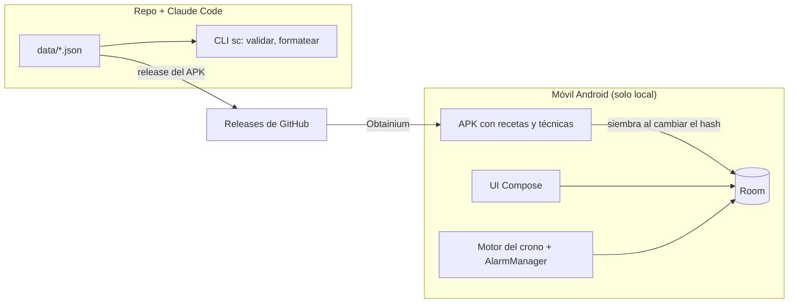
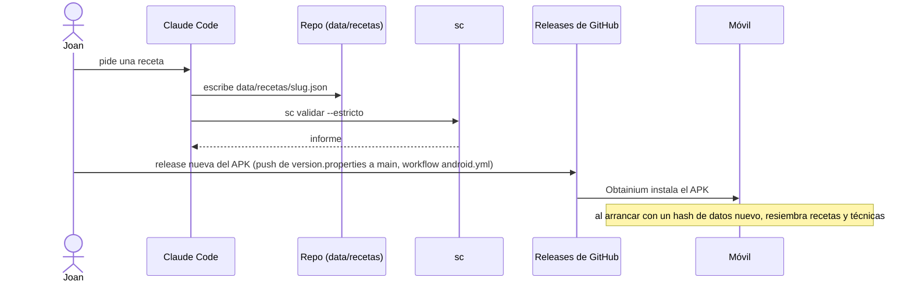
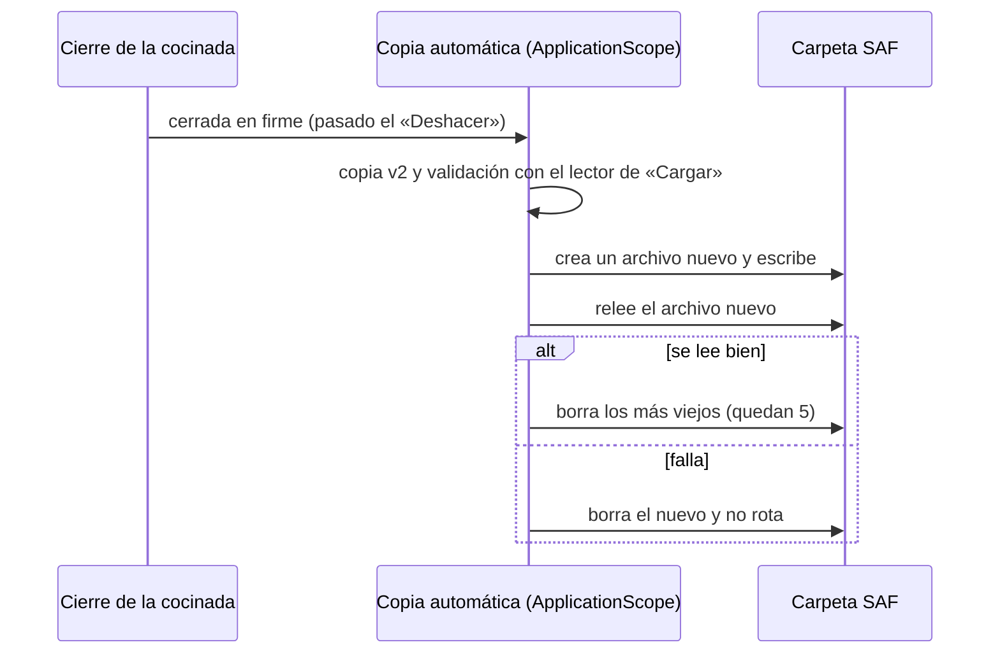

# Arquitectura

> Propósito: describir la arquitectura de Sous Chef, sus componentes y fronteras · Audiencia: desarrolladores y agentes · Actualizado: 2026-10-25 · Relacionado: docs/adr/, docs/herramientas.md, docs/spec/app-legado.md

## Resumen
Sous Chef es una app Android personal de recetas cronometradas que funciona solo en local ([ADR-0007](adr/0007-app-solo-local-sin-supabase.md)). Las recetas se escriben y validan en este repo con Claude Code, y viajan empaquetadas en el APK desde `data/`. La app lee recetas y técnicas, guarda historial, preferencias y ajustes en Room, y ejecuta el cronómetro con alarmas del sistema. No hay backend, sync ni login, y la app no usa la red: no pide permisos de Internet ([ADR-0011](adr/0011-sin-aviso-de-version-nueva.md)). Las actualizaciones obligatorias las fuerza Play con la API In-App Updates, sin permiso de red ([ADR-0013](adr/0013-actualizacion-obligatoria-desde-play.md)). **Estado:** descripción de la arquitectura actual; se implementa por fases (`docs/fases/`).

## Principios
| Principio | Consecuencia arquitectónica |
|---|---|
| El repo manda en las recetas | `data/*.json` es la fuente de verdad. El APK empaqueta `data/` y se re-siembra por hash al arrancar con datos nuevos ([ADR-0007](adr/0007-app-solo-local-sin-supabase.md)); la app nunca edita recetas ([ADR-0003](adr/0003-el-repo-manda-en-las-recetas.md)). |
| Una sola implementación de las reglas | Validador y motor del crono en `:receta`, compartidos por la app y la CLI ([ADR-0001](adr/0001-stack-android-y-modulos.md)). |
| Una receta, cualquier cocina | Las recetas se escriben en vitro 0-9 con la potencia marcada como `{N}`; la app la traduce a la cocina del usuario ([ADR-0014](adr/0014-cocina-configurable-y-potencia-marcada.md)). |
| Solo local: Room es la única persistencia | Room es la fuente de la UI y guarda todo lo que escribe el usuario (historial, preferencias, ajustes, estado del crono). Sin sync ni outbox. |
| Avisos fiables sin servicio permanente | Cadena de una alarma `setAlarmClock` con estado en Room ([ADR-0005](adr/0005-cronometro-alarmas-sin-fgs.md)). |
| Secretos fuera del repo | Firma de release en `~/.souschef/` y `local.properties`; nunca en el repo. |

## Diagrama de contexto


## Flujos
### Publicar una receta


### Actualizar la app
1. El CI sube cada versión a Play con `inAppUpdatePriority: 5`. Para una versión no obligatoria se baja a 3.
2. Al abrir la app instalada desde Play, con prioridad ≥ 4 y sin cocinada viva, `MainActivity` lanza la pantalla de actualización inmediata.
3. Si el usuario la cancela o falla (p. ej. sin red), no vuelve a salir hasta el siguiente arranque en frío. La app sigue funcionando sin red ([ADR-0013](adr/0013-actualizacion-obligatoria-desde-play.md)).

### Historial y preferencias
1. La UI escribe directamente en Room. No hay red, cola ni sincronización.
2. El historial se conserva fuera de la app con la copia de Ajustes → Historial: manual («Guardar copia») o automática en una carpeta elegida con SAF ([ADR-0007](adr/0007-app-solo-local-sin-supabase.md), ampliado por [ADR-0015](adr/0015-copia-automatica-del-historial-en-carpeta-saf.md)). Sin carpeta elegida ni copia manual, si se pierde el móvil se pierde el historial.

### Copia automática del historial
1. La carpeta se elige una vez (`OpenDocumentTree` + permiso persistente). Sin permisos de almacenamiento ni red. La URI se guarda en `meta` y no va al log.
2. Cuando una cocinada queda cerrada en firme, pasado el «Deshacer», una corrutina en `@ApplicationScope` escribe un archivo nuevo `souschef-historial-AAAAMMDD-HHmm.json` (copia v2) con `EscrituraSegura`, lo relee y solo entonces borra los más viejos. Quedan los 5 últimos.
3. Si la carpeta deja de valer, la app enseña un aviso. Ajustes dice «Última copia: hace N días». Restaurar sigue siendo manual con «Cargar copia» ([ADR-0015](adr/0015-copia-automatica-del-historial-en-carpeta-saf.md)).



### Cocinar con alarmas
1. "Abrir la cocina" pide `POST_NOTIFICATIONS` y crea el estado del crono en Room (`finAt` en reloj de pared).
2. El motor calcula el próximo evento y se programa **una** alarma `setAlarmClock`.
3. Al saltar, el receiver recarga Room, emite lo vencido (hitos con más de 90 s de retraso se marcan sin sonar) y programa la siguiente.
4. Si el proceso muere o el móvil reinicia, `BOOT_COMPLETED`, `MY_PACKAGE_REPLACED`, `TIME_SET` o `TIMEZONE_CHANGED` reprograman la cadena ([ADR-0005](adr/0005-cronometro-alarmas-sin-fgs.md)).
5. Los temporizadores libres («+ Temporizador» o «Chef, pon N minutos») van en `EstadoCrono.libres`, fuera de `Plano`, de los fuegos y de `pasosReales`. Avisan por la misma cadena y la misma alarma agrupada. Un libre sin avisar mantiene viva la cocinada ([ADR-0016](adr/0016-temporizador-libre-y-recordatorio-de-empezar.md)).
6. «Avísame para empezar» arma una alarma propia (requestCode 4102) a la hora de empezar de la receta. Su estado está en `meta` y lo reprograman los mismos receivers. Avisa con una notificación normal que abre la ficha, no cuenta como cocinada viva y se cancela al abrir la cocina ([ADR-0016](adr/0016-temporizador-libre-y-recordatorio-de-empezar.md)).

La potencia del texto (`{N}`) se muestra en la cocina del usuario. El motor, las casillas y lo guardado usan la receta canónica ([ADR-0014](adr/0014-cocina-configurable-y-potencia-marcada.md)).

### Cocinado a historial
1. Al terminar, el motor produce el resumen con `pasosReales`; la persona añade una nota.
2. Se escribe una fila de `historial` en Room con id `slug-fecha-HHMMSS`.
3. Se muestra "Deshacer" durante 12 s. El estado del crono se borra (solo local).
4. La nota vuelve a salir como «La última vez» en la ficha de esa receta y en la portada del cronómetro (`notasDe` en `domain/NotaCocinada.kt`, leída del historial; sin tabla nueva). Los títulos de `pasosReales` se guardan canónicos, con `{N}`.

## Límites de componentes
| Módulo | Paquete | Responsabilidad | No puede |
|---|---|---|---|
| `:app` | `domain/` | Casos de uso, interfaces de repositorio | Depender de `data/` ni `ui/` ni Android (`DomainDependencyRuleTest`) |
| `:app` | `data/` | Room (entidades, DAOs, siembra de recetas desde el APK) | Contener lógica de UI |
| `:app` | `ui/` | Pantallas Compose, navegación, tema | Acceder a Room o red directamente |
| `:app` | alarmas y notificaciones | `AlarmManager`, receivers, canales | Mantener estado fuera de Room |
| `:receta` | modelos | Receta, técnica, despensa (kotlinx-serialization, campos opcionales tolerantes) | Acceder a disco o entorno |
| `:receta` | escalado y formato | `esc:"sub"` (f^0,75), números ("2,5") | Depender de Android |
| `:receta` | cocina y potencia | Traducir `{N}` a vitro, inducción o gas (`Potencia.kt`, [ADR-0014](adr/0014-cocina-configurable-y-potencia-marcada.md)) | Guardar la receta traducida: solo la UI la recibe |
| `:receta` | gantt | Plan y huella de fuegos | Depender de Android |
| `:receta` | validador | 12 comprobaciones, completitud, plurales, `--estricto`, `mep` solo `<b>` | Escribir ficheros |
| `:receta` | motor del crono | Máquina de estados con `Clock` inyectado | Usar el reloj real |
| `:tools` | CLI `sc` | validar, formatear | Contener reglas de dominio (viven en `:receta`) |

## Estructura del repo
```
app/  receta/  tools/  gradle/  settings.gradle.kts  build.gradle.kts
data/recetas/*.json  data/tecnicas/*.json  data/legado/{historial,preferencias}.json
docs/ ESTADO.md decisiones.md arquitectura.md pasos-manuales.md testing.md ci-cd.md
      adr/ fases/ _templates/ cocina/{reglas.md,perfil.md,esquema-receta.md,entregables.md,sugerencias-compra.md}
      spec/app-legado.md (inventario funcional completo de la app vieja)  legado/sous-chef-publicada.html
.claude/ settings.json hooks/ skills/ agents/      scripts/ sc.ps1 sc.cmd check-claude-assets.mjs test-hooks.sh
.github/ workflows/{android.yml,claude-assets.yml} dependabot.yml pull_request_template.md
CLAUDE.md README.md .editorconfig .gitattributes .gitignore .env.example
```

## Decisiones y fuentes
- [ADR-0001 Stack y módulos](adr/0001-stack-android-y-modulos.md)
- [ADR-0002 Supabase compartido, esquema `sous_chef`](adr/0002-supabase-compartido-esquema-sous-chef.md) (sustituido por ADR-0007)
- [ADR-0003 El repo manda en las recetas](adr/0003-el-repo-manda-en-las-recetas.md) (revisado por ADR-0007)
- [ADR-0004 Sync outbox y LWW](adr/0004-sync-outbox-lww.md) (sustituido por ADR-0007)
- [ADR-0005 Cronómetro con alarmas, sin FGS](adr/0005-cronometro-alarmas-sin-fgs.md) (anexo: ADR-0016)
- [ADR-0006 Ficha nativa e impresión HTML](adr/0006-ficha-nativa-e-impresion-html.md)
- [ADR-0007 Solo local, sin Supabase](adr/0007-app-solo-local-sin-supabase.md) (matizado por ADR-0009 y retirado por ADR-0011; ampliado por ADR-0015)
- [ADR-0008 Voz en el cronómetro](adr/0008-voz-en-el-cronometro.md)
- [ADR-0009 Aviso de versión nueva](adr/0009-aviso-de-version-nueva.md) (sustituido por ADR-0011)
- [ADR-0010 Distribución por Google Play](adr/0010-distribucion-por-google-play.md)
- [ADR-0011 Sin aviso de versión nueva](adr/0011-sin-aviso-de-version-nueva.md)
- [ADR-0012 Vídeo promocional con Remotion](adr/0012-video-promocional-con-remotion.md)
- [ADR-0013 Actualización obligatoria desde Play](adr/0013-actualizacion-obligatoria-desde-play.md) (complementa ADR-0011)
- [ADR-0014 Cocina configurable y potencia marcada](adr/0014-cocina-configurable-y-potencia-marcada.md)
- [ADR-0015 Copia automática del historial en una carpeta SAF](adr/0015-copia-automatica-del-historial-en-carpeta-saf.md) (amplía ADR-0007)
- [ADR-0016 Temporizador libre y «Avísame para empezar»](adr/0016-temporizador-libre-y-recordatorio-de-empezar.md) (anexo de ADR-0005)
- CLI y herramientas: [herramientas](herramientas.md). Inventario funcional del legado: [spec](spec/app-legado.md).

## Pendiente
- Spike de alarmas (F1) retirado: las alarmas ya están probadas en el móvil; el código de debug se ha borrado.
- VERIFICAR (ADR-0015 y ADR-0016): ver el Seguimiento de cada ADR (nombres repetidos y `sync()` en SAF; política de Play de `USE_EXACT_ALARM` para el recordatorio).
- VERIFICAR (ADR-0013): que el manifest fusionado del release no contiene `INTERNET`, y que la pantalla de Play sale al publicar una versión nueva en la pista interna.
