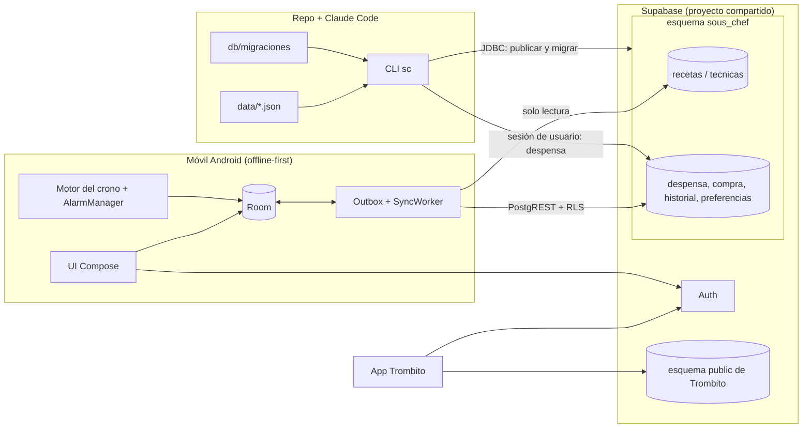
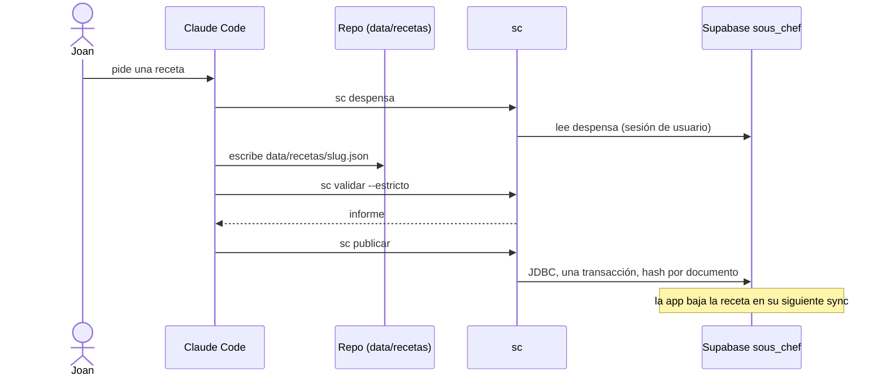

# Arquitectura

> Propósito: describir la arquitectura de Sous Chef, sus componentes y fronteras · Audiencia: desarrolladores y agentes · Actualizado: 2026-10-13 · Relacionado: docs/adr/, docs/herramientas.md, docs/spec/app-legado.md

## Resumen
Sous Chef es una app Android personal de recetas cronometradas. Las recetas se escriben y validan en este repo con Claude Code y se publican a Supabase (esquema `sous_chef`, proyecto compartido con Trombito) en una sola dirección. La app lee recetas y técnicas, edita despensa, lista de la compra, historial y preferencias de forma offline-first, y ejecuta el cronómetro con alarmas del sistema. **Estado:** descripción de la arquitectura objetivo; se implementa por fases (`docs/fases/`).

## Principios
| Principio | Consecuencia arquitectónica |
|---|---|
| El repo manda en las recetas | `data/*.json` es la fuente de verdad; `sc publicar` sube; la app nunca edita recetas ([ADR-0003](adr/0003-el-repo-manda-en-las-recetas.md)). |
| Una sola implementación de las reglas | Validador y motor del crono en `:receta`, compartidos por la app y la CLI ([ADR-0001](adr/0001-stack-android-y-modulos.md)). |
| Offline-first | Room es la fuente de la UI; las escrituras van al outbox y se sincronizan después ([ADR-0004](adr/0004-sync-outbox-lww.md)). |
| No tocar lo de Trombito | Esquema propio y runner de migraciones propio; nunca `db push` ni `apply_migration` ([ADR-0002](adr/0002-supabase-compartido-esquema-sous-chef.md)). |
| Avisos fiables sin servicio permanente | Cadena de una alarma `setAlarmClock` con estado en Room ([ADR-0005](adr/0005-cronometro-alarmas-sin-fgs.md)). |
| Multiusuario desde el día 1 | Toda tabla de usuario lleva `user_id` con RLS; `recetas`/`tecnicas` solo SELECT. |
| Secretos fuera del repo | `~/.souschef/` y `local.properties`; nunca la service role ([ADR-0003](adr/0003-el-repo-manda-en-las-recetas.md)). |

## Diagrama de contexto


## Flujos
### Publicar una receta


### Editar la despensa sin conexión
1. La UI escribe en Room y, en la misma transacción, añade la entrada al outbox.
2. Un `SyncWorker` con red empuja el outbox con upserts idempotentes.
3. Después baja cada tabla con `updated_at > cursor - 5 min`, sin pisar filas con outbox pendiente.
4. Conflictos: last-write-wins por `editado_en`; un trigger rechaza updates más viejos ([ADR-0004](adr/0004-sync-outbox-lww.md)).

### Cocinar con alarmas
1. "Abrir la cocina" pide `POST_NOTIFICATIONS` y crea el estado del crono en Room (`finAt` en reloj de pared).
2. El motor calcula el próximo evento y se programa **una** alarma `setAlarmClock`.
3. Al saltar, el receiver recarga Room, emite lo vencido (hitos con más de 90 s de retraso se marcan sin sonar) y programa la siguiente.
4. Si el proceso muere o el móvil reinicia, `BOOT_COMPLETED`, `MY_PACKAGE_REPLACED`, `TIME_SET` o `TIMEZONE_CHANGED` reprograman la cadena ([ADR-0005](adr/0005-cronometro-alarmas-sin-fgs.md)).

### Cocinado a historial
1. Al terminar, el motor produce el resumen con `pasosReales`; la persona añade una nota.
2. Se escribe una fila de `historial` en Room con id `slug-fecha-HHMMSS` y su entrada de outbox.
3. Se muestra "Deshacer" durante 8 s; si no se usa, la sync la sube. El estado del crono se borra (solo local).

## Límites de componentes
| Módulo | Paquete | Responsabilidad | No puede |
|---|---|---|---|
| `:app` | `domain/` | Casos de uso, interfaces de repositorio | Depender de `data/` ni `ui/` ni Android (`DomainDependencyRuleTest`) |
| `:app` | `data/` | Room, outbox, `SyncWorker`, supabase-kt, sesión cifrada | Contener lógica de UI |
| `:app` | `ui/` | Pantallas Compose, navegación, tema | Acceder a Room o red directamente |
| `:app` | alarmas y notificaciones | `AlarmManager`, receivers, canales | Mantener estado fuera de Room |
| `:receta` | modelos | Receta, técnica, despensa (kotlinx-serialization, campos opcionales tolerantes) | Acceder a disco o entorno |
| `:receta` | escalado y formato | `esc:"sub"` (f^0,75), números ("2,5") | Depender de Android |
| `:receta` | gantt | Plan y huella de fuegos | Depender de Android |
| `:receta` | validador | 12 comprobaciones, completitud, plurales, `--estricto`, `mep` solo `<b>` | Escribir ficheros |
| `:receta` | motor del crono | Máquina de estados con `Clock` inyectado | Usar el reloj real |
| `:tools` | CLI `sc` | validar, publicar, comparar, despensa, migrar, importar-legado | Contener reglas de dominio (viven en `:receta`) |

## Estructura del repo
```
app/  receta/  tools/  gradle/  settings.gradle.kts  build.gradle.kts
data/recetas/*.json  data/tecnicas/*.json  data/legado/{historial,preferencias}.json  data/despensa-semilla.md
db/migraciones/*.sql  db/tests/*.sql  supabase/config.toml (solo para el stack local)
docs/ ESTADO.md decisiones.md arquitectura.md pasos-manuales.md testing.md ci-cd.md
      adr/ fases/ _templates/ cocina/{reglas.md,perfil.md,esquema-receta.md,entregables.md,sugerencias-compra.md}
      spec/app-legado.md (inventario funcional completo de la app vieja)  legado/sous-chef-publicada.html
.claude/ settings.json hooks/ skills/ agents/      scripts/ sc.ps1 sc.cmd check-claude-assets.mjs test-hooks.sh
.github/ workflows/{android.yml,release-android.yml,claude-assets.yml} dependabot.yml pull_request_template.md
CLAUDE.md README.md .editorconfig .gitattributes .gitignore .env.example
```

## Decisiones y fuentes
- [ADR-0001 Stack y módulos](adr/0001-stack-android-y-modulos.md)
- [ADR-0002 Supabase compartido, esquema `sous_chef`](adr/0002-supabase-compartido-esquema-sous-chef.md)
- [ADR-0003 El repo manda en las recetas](adr/0003-el-repo-manda-en-las-recetas.md)
- [ADR-0004 Sync outbox y LWW](adr/0004-sync-outbox-lww.md)
- [ADR-0005 Cronómetro con alarmas, sin FGS](adr/0005-cronometro-alarmas-sin-fgs.md)
- [ADR-0006 Ficha nativa e impresión HTML](adr/0006-ficha-nativa-e-impresion-html.md)
- CLI y herramientas: [herramientas](herramientas.md). Inventario funcional del legado: [spec](spec/app-legado.md).

## Pendiente
- `VERIFICAR` que `sous_chef` está expuesto en la Data API antes de la primera sync remota (F3).
- Spike de alarmas en emulador (F1) y repetición en el móvil real en la sesión final.
